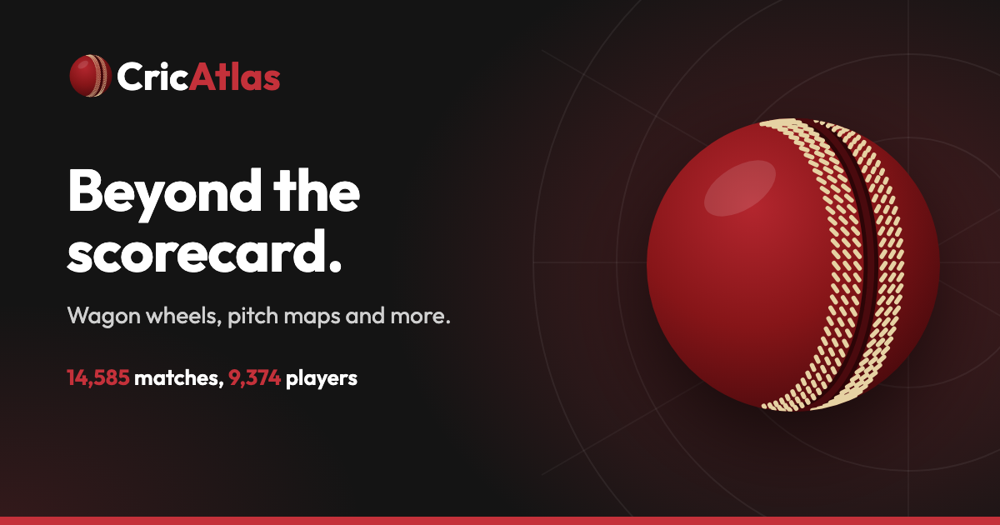
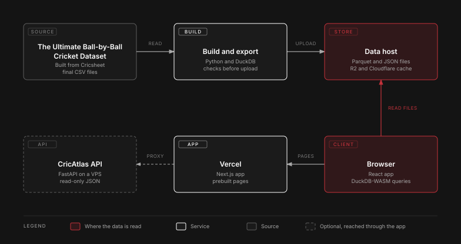

# 🏏 CricAtlas



## Overview

CricAtlas is a web app for exploring ball-by-ball cricket. Open a player and see their career, shots and form. Open a match and replay it ball by ball. Compare two players or two teams. It lives at <https://cricatlas.ariadaikalam.com>, and its data is also open through an [API](https://cricatlas.ariadaikalam.com/api).

> Statistics reflect the matches available in this Cricsheet snapshot and may not represent complete career records or official totals.

## Take a look

| Page | What it shows | Try |
|---|---|---|
| Player | Career numbers, form, shots, the wagon wheel, bowlers faced, dismissals and full stats | [V Kohli](https://cricatlas.ariadaikalam.com/players/v-kohli-ba607b88) |
| Match | The summary, the scorecard, an analysis of the innings and a ball-by-ball replay | [India v Pakistan](https://cricatlas.ariadaikalam.com/matches/1298150) |
| Team | Results by format, players, and batting, bowling and fielding | [India](https://cricatlas.ariadaikalam.com/teams/india~intl~male) |
| Tournament | Editions, tables, finals and top performers | [IPL](https://cricatlas.ariadaikalam.com/tournaments/ipl) |
| Compare | Two players or two teams, side by side or head to head | [Kohli and Starc](https://cricatlas.ariadaikalam.com/compare/players?a=ba607b88&b=3fb19989) |
| Records | Record lists by format or competition, men or women, in seven categories | [Records](https://cricatlas.ariadaikalam.com/records) |
| API | Every route, with requests you can send from the page | [API](https://cricatlas.ariadaikalam.com/api) |

## Why I built it

I love cricket and I build things that work. CricAtlas started with one question: what really happened on ball 3.5 of Sri Lanka v Pakistan, 2022? I wanted the answer to feel like a live broadcast, with an analyst's depth behind it.

## How it works

<picture>
  <source media="(prefers-color-scheme: dark)" srcset="docs/diagrams/architecture-light.svg">
  
</picture>

An export step turns the dataset's final tables into small Parquet and JSON files, checks them, and uploads them to a bucket behind Cloudflare's cache. The app is a Next.js site with one prebuilt page for each section. The browser loads the page, then fetches the files it needs from the data host and answers questions with DuckDB-WASM. No page needs a database server. The API page is the exception: Vercel passes its requests through to the separate CricAtlas API.

The first screen of a page asks for one small file. The browser fetches each page's data whole, and the build prepares it ahead of time.

The reasons for these choices are in [design decisions](docs/design_decisions.md).

## Speed

Every page has a budget: a first look in under 500 ms on a warm cache and under 1 s on a cold visit, and a filter change in under 300 ms. On 2026-11-06 every cold visit to the ten pages measured finished under 1 s, including with 60 ms latency and 20 Mbit. The unthrottled cold visits took 133 to 414 ms, and warm visits 39 to 198 ms. Nine filter changes on the busiest players took 23 to 58 ms. No frame went over 50 ms while scrolling the tile row. The method and the numbers for each page are in the [performance report](docs/performance_report.md).

## Care taken

- **Real 404s**: an address with no player, match, team or tournament behind it answers 404. The check is a lookup in a list written at build time, so it costs no request.
- **Secrets stay on the server**: the API credential is read when a request arrives and never reaches the browser. A strict content security policy limits what a page can load.
- **Reduced motion**: charts draw in and lists move. With reduced motion on, they show their finished state at once.
- **Checked against the data**: totals are compared with a second calculation, and the geometry for the wagon wheel is tested against the dataset's own code.
- **Checked in real browsers**: scripts measure speed and look for animations that play twice, in Chromium and WebKit, and a set of scripts runs in Safari.

## Coverage and limits

CricAtlas calculates statistics from the matches included in its Cricsheet snapshot. Cricsheet does not provide every cricket match, and some matches are withheld or unavailable. Totals such as runs, wickets, appearances and centuries may differ from official records. Coverage starts in 2001.

Cricsheet withholds all Afghanistan men's matches and the Afghanistan Premier League, so a player's or a team's totals can be short in a way the data cannot show.

## Data source

- **Ball-by-ball and match data**: [Cricsheet](https://cricsheet.org/), released under the [Open Data Commons Attribution License 1.0](https://opendatacommons.org/licenses/by/1-0/). Contains data from Cricsheet, used with attribution.
- **The snapshot this app uses**: [The Ultimate Ball-by-Ball Cricket Dataset](https://github.com/ari-adaikalam/The-Ultimate-Ball-by-Ball-Cricket-Dataset).

## Built with

| Part | Used for |
|---|---|
| Next.js, React, TypeScript | The app, with strict types and one prebuilt page per section |
| DuckDB-WASM | Queries, run in the browser over the data files |
| Python, DuckDB | The export step, which stops if a check fails |
| Parquet, Cloudflare R2 | How the data is stored and served, behind Cloudflare's cache |
| Three.js, d3 | The wagon wheel, the replay and the charts |
| Vercel | Hosting, deployed by hand |
| Vitest, Playwright | Unit tests, and browser checks in Chromium, WebKit and Safari |

## How it was built

- **Claude (Sonnet 5.5, medium effort)**: did all of the implementation.
- **Codex (GPT-6.1 Sol, high effort)**: planned the project and made the decisions together with me, then reviewed each step for the code and for whether it met the requirements.
- **VibeSec Pro**: the security check ran after each phase, from [vibesec.sh](https://vibesec.sh).

## Run it yourself

You need Node.js 24. The checks need no data, so this works from a fresh clone:

```
cd web
npm ci
npx next typegen
npm test
npm run typecheck
```

To run the app you also need the data files. `tools/export.py` writes them from the dataset's final CSV files, which a separate pipeline builds from the Cricsheet archives and which are not part of this repository. `npm run data` then serves the output folder on port 8788, and `NEXT_PUBLIC_DATA_BASE_URL` in `web/.env.local` points the app at it (copy `web/.env.example`). Then run `npm run dev`.

## License

The code is released under the MIT License, see the [LICENSE](LICENSE) file. The data keeps its own licence, above.

## Contact

Developed and maintained by Ari Adaikalam. [Portfolio](https://ariadaikalam.com) | [Email](mailto:ariadaikalam1234@gmail.com)

Bug reports, data discrepancies and suggestions are welcome.
