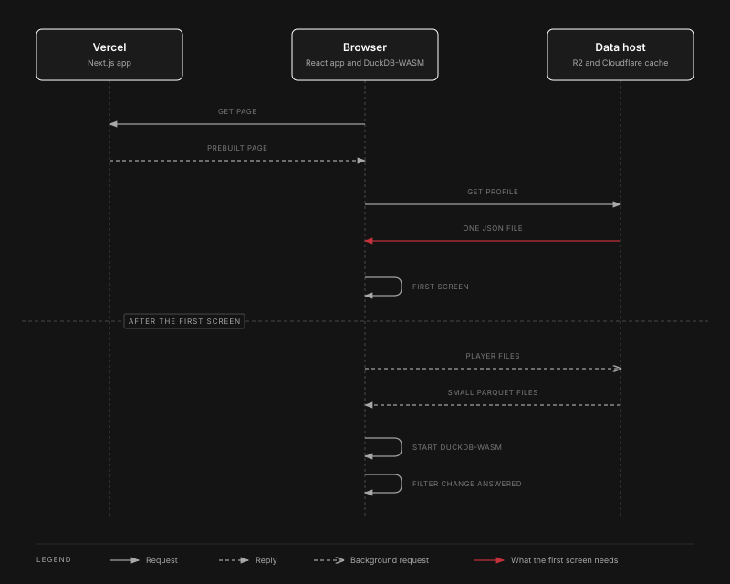

# Design decisions

How CricAtlas is built and why. It describes what is live. How fast it is, and how that was measured, is in [performance_report.md](performance_report.md).

## Purpose

A web app for exploring ball-by-ball cricket, at <https://cricatlas.ariadaikalam.com>. It is a portfolio piece and a tool for cricket fans. The data comes from Cricsheet, through the snapshot in [The Ultimate Ball-by-Ball Cricket Dataset](https://github.com/ari-adaikalam/The-Ultimate-Ball-by-Ball-Cricket-Dataset).

## Scope and decisions

- **No database server.** A build step turns the dataset's final tables into small Parquet and JSON files and checks them before anything is published. The browser reads those files. The app does not call the CricAtlas API, except on the API page.
- **Hosting.** The app is on Vercel and the files are in a Cloudflare R2 bucket behind Cloudflare's cache. Vercel was chosen over Cloudflare Pages because one page for every player and match is more than a Pages site's file limit.
- **The big tables never reach the browser.** The ball file is 2.4 GB as CSV. A page gets its own small files, and the browser fetches each one whole.
- **One definition for each rule.** The wagon wheel geometry, zone names and left-hander mirroring come from the dataset's code, and the app reads the exported columns without re-deriving them. A tile's numbers come from one shared module for each metric. The geometry tests compare the TypeScript with the dataset's Python.
- **Statistics are not official totals.** They are calculated from the matches in the Cricsheet snapshot, and the README says so.
- **Every format, from the start.** Anything built for Tests, ODIs, T20s and Super Overs also works for The Hundred, which counts balls, has a 25-ball Powerplay and shows economy per 5 balls.
- **Gender-neutral copy.** Players include women, so copy avoids he and him. It uses no pronoun, or a helper that follows the player's gender in the data.

## Stack

- Next.js and React with strict TypeScript. Charts are SVG and d3. The wagon wheel, the pitch map and the replay use Three.js, with a flat top-down wheel for browsers without WebGL and for reduced motion.
- DuckDB-WASM, started in the browser only when a question needs it.
- A Python and DuckDB export step in `tools/`, with checks on its own output (columns, row counts, no duplicates).
- Vitest for unit tests and Playwright for browser checks.

## How the data reaches the browser

<picture>
  <source media="(prefers-color-scheme: dark)" srcset="diagrams/page-load-light.svg">
  
</picture>

1. **A file per player, read whole.** The export splits the big tables into one small Parquet file for each player and kind (batting, bowling, dismissals and so on). The browser fetches a file with one plain GET. There are no Range requests, because a Range header makes a cross-origin request wait for an extra round trip and forces stepwise reads.
2. **A profile is one JSON file.** It holds everything the profile page shows, so the page needs one request and no query engine. It is built by running the app's own loaders in Node, so the numbers are the browser's own.
3. **The default view is recorded.** The first look at a view asks the same questions every time. The build runs the view's loaders, records each answer under a hash of its question, and the browser replays the answer. The view components call the same loaders either way, so a changed filter and a first look cannot disagree.
4. **Background work after the first screen.** The engine's download and start, the player's other files and the likely next views load behind the page. Hovering a search result fetches that player's files, so Change player opens at once.
5. **Files are never overwritten.** Every file sits under a version prefix and carries `Cache-Control: public, max-age=31536000, immutable`. A new export is a new prefix, so nothing is purged and nothing goes stale.
6. **Each tile fills in on its own.** Recorded answers show at once, and the tiles that need every ball wait for the engine without holding the others back.

## Pages and addresses

- Every real player, match, team and tournament address is rewritten to one prebuilt page for its section, and the browser reads which address it is. A first visit to an address nobody has opened is served from the edge like any other.
- An address with nothing behind it answers 404. The check is a lookup in a list written at build time, so it costs no request.
- A move inside the app changes the address without a page load, and each page listens for it.
- A table or list that can pass 60 rows draws only the rows on screen.

## Interface rules

- Every chart is animated, has a tooltip, and shows its finished state at once with reduced motion on. Tables and lists move too: rows reveal in turn, slide when the order changes, and count up.
- A page opens at once and never waits for data before it shows. What a visitor can open next is loaded behind the page they are on, and the loading ball is for a filter change only.
- A team's name carries its emblem wherever it labels something.
- Filters all narrow one data set that every tile reads. Impossible combinations are blocked, and possible but empty ones show an empty state.

## Security

The app is a read-only site with no accounts, no forms, no server actions and no database.

- **Addresses to files.** A data address is built only after a strict pattern matches the slug, so a request cannot be pointed at another host or path.
- **Secrets.** The only public variables are the data host, the API host and the engine version. The API credential is read on the server when a request arrives and never reaches the browser.
- **Headers.** A content security policy, `X-Content-Type-Options`, `Referrer-Policy` and `X-Frame-Options` are set. Development pages are not built into production, and no source maps are emitted.
- **The API page** sends only paths that start with `/v1/` or are `/health`, to a fixed address, so a path cannot change the host.
- **Dependencies.** `npm audit --omit=dev` found no vulnerabilities when it was run for the security review.

## Testing

- Unit tests for the metrics, filters, geometry and the export step.
- GitHub Actions runs the type check, ESLint, the tests and the build on every push, with read-only permissions and the actions pinned to a commit.
- Browser checks in Chromium and WebKit measure speed and look for animations that play twice. A set of scripts also runs in Safari.
- A separate set of scripts compares each tile's numbers with a second calculation and checks the recorded answers against live queries.

## Known limits

- Querying in the browser has a practical size limit. A view that needs more than that uses a table built ahead of time.
- Coverage is whatever Cricsheet provides, starting in 2001.
